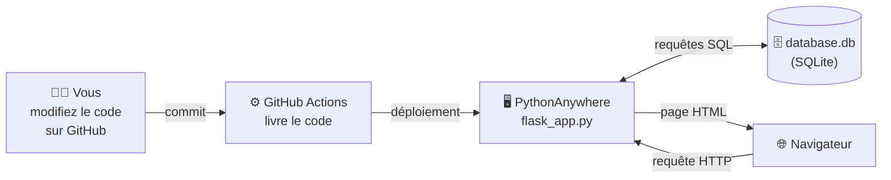

# 🗄️ Atelier « Flask + SQLite » : construire une application avec une base de données

Bienvenue ! 👋

Presque toutes les applications que vous utilisez (un réseau social, une boutique en ligne, l'ENT de votre école…) font la même chose : **elles enregistrent des informations dans une base de données, puis elles vous les restituent**.

Dans cet atelier, vous allez **mettre en ligne une petite application Web reliée à une base de données**, puis la faire évoluer pas à pas : lire des données, les filtrer, en enregistrer, les modifier, relier plusieurs tables, protéger l'accès, exposer une API… Jusqu'à construire **votre propre application de gestion de bibliothèque** lors de la séquence 6.

> 🎯 **Objectif :** savoir construire une petite solution complète *formulaire → serveur → base de données → page Web*, et comprendre chaque maillon de la chaîne.

**Prérequis :** savoir lire quelques lignes de Python. Aucune connaissance en base de données n'est nécessaire.
**Ce qu'il vous faut :** un navigateur (Chrome, Firefox ou Edge), un compte GitHub et une adresse e-mail.

---

## 🗺️ Comment ça marche ?

| Outil | Son rôle | Analogie |
|---|---|---|
| **GitHub** | Stocker votre code et garder l'historique de vos modifications | Votre classeur de travail |
| **GitHub Actions** | Envoyer automatiquement votre code sur le serveur à chaque modification | Le livreur |
| **PythonAnywhere** | Le serveur qui fait tourner votre application **Flask** | La boutique ouverte au public |
| **SQLite** | La base de données : un simple fichier `database.db` sur le serveur | L'entrepôt où l'on range tout |



> 💡 Remarquez que **la base de données reste sur le serveur** : elle n'est pas dans GitHub, et le robot de déploiement ne la touche jamais. Ainsi, les données saisies par vos utilisateurs ne sont pas écrasées à chaque modification du code.

**La boucle de travail** que vous répéterez à chaque exercice :

1. ✏️ Vous modifiez un fichier **directement sur le site de GitHub** (icône crayon ✏️), puis vous cliquez sur **Commit changes**.
2. ⏳ Vous patientez ~30 secondes : l'onglet **Actions** de votre dépôt affiche une pastille jaune 🟡, puis verte ✅.
3. 🔄 Vous rechargez votre site dans le navigateur : votre modification est en ligne !

---

## 🧩 Séquence 1 : Créer votre dépôt GitHub

**Objectif :** obtenir votre propre copie de l'atelier
**Difficulté :** très facile (~10 minutes)

1. Si vous n'en avez pas encore, créez un compte sur **https://github.com** (avec une adresse e-mail valide : GitHub refuse les adresses temporaires). Si vous avez déjà un compte, gardez-le.
2. En haut de cette page, cliquez sur le bouton vert **Use this template** → **Create a new repository**.
3. Donnez un nom à votre dépôt (par exemple `flask-sqlite`), laissez-le en **Public**, puis cliquez sur **Create repository**.

Vous avez maintenant **votre propre dépôt**, indépendant de celui de l'enseignant. C'est lui que vous modifierez pendant tout l'atelier.

> ⚠️ Dans l'onglet **Actions** de votre nouveau dépôt, vous verrez peut-être déjà une croix rouge ❌. **C'est normal !** Le robot a essayé de déployer votre site, mais il ne sait pas encore où l'envoyer. On règle ça dans la séquence 3.

**Travail demandé :** copiez l'URL de votre dépôt GitHub dans la discussion publique.

---

## 🧩 Séquence 2 : Créer votre hébergement chez PythonAnywhere

**Objectif :** obtenir un serveur gratuit, accessible depuis Internet
**Difficulté :** facile (~10 minutes)

> ⚠️ **Important : laissez le site PythonAnywhere en anglais !** Si votre navigateur vous propose de traduire la page en français, **refusez**. Les consignes utilisent les noms anglais des boutons (*Web*, *Add a new web app*, *Account*…). La traduction peut aussi modifier les chemins de fichiers et les noms d'utilisateur affichés, et vous recopieriez alors de mauvaises valeurs dans vos secrets.

1. Rendez-vous sur **<a href="https://www.pythonanywhere.com" target="_blank">https://www.pythonanywhere.com</a>** (astuce : **Ctrl + clic**, ou **Cmd + clic** sur Mac, pour garder ces consignes sous les yeux) et créez un compte gratuit (**Pricing & signup** → **Create a Beginner account**).
   👉 Notez bien votre **nom d'utilisateur** (*username*), vous en aurez besoin.
2. Une fois connecté, ouvrez l'onglet **Web** (en haut à droite) puis cliquez sur **Add a new web app**.
3. Suivez l'assistant :
   - **Next** (le nom de domaine proposé est `votre-username.pythonanywhere.com`)
   - Choisissez le framework **Flask**
   - Choisissez la version de Python la plus récente
   - Laissez le chemin proposé tel quel : `/home/votre-username/mysite/flask_app.py` → **Next**
4. Cliquez sur le lien de votre site (`https://votre-username.pythonanywhere.com`) : vous devez voir *« Hello from Flask! »*. 🎉
   Votre serveur fonctionne ! Pour l'instant il affiche un code d'exemple, pas encore le vôtre.
5. Dernière chose : créez un **jeton d'API** (une sorte de mot de passe pour le robot de GitHub) :
   menu **Account** → onglet **API Token** → **Create a new API token**. Gardez cette page ouverte.

**Travail demandé :** copiez l'URL de votre site dans la discussion publique.

---

## 🧩 Séquence 3 : Relier GitHub et PythonAnywhere (Actions et secrets)

**Objectif :** automatiser la mise à jour de votre hébergement
**Difficulté :** moyenne (~15 minutes)

Dans votre dépôt se trouve un fichier `.github/workflows/deploy-pythonanywhere.yml`. C'est une **GitHub Action** : un petit programme qui s'exécute **automatiquement à chaque modification** (*commit*) de votre code, et qui envoie vos fichiers sur PythonAnywhere. On appelle ça du **déploiement continu** (CI/CD).

Pour fonctionner, ce robot a besoin de votre nom d'utilisateur et de votre jeton d'API. Mais votre dépôt est **public** : il ne faut surtout pas écrire ces informations dans le code ! On les range donc dans des **secrets**, invisibles pour les visiteurs.

Dans votre dépôt GitHub : **Settings → Secrets and variables → Actions → New repository secret**, puis créez ces **4 secrets** (attention aux majuscules) :

| Nom du secret | Valeur | Exemple |
|---|---|---|
| `PA_USERNAME` | votre nom d'utilisateur PythonAnywhere | `alice42` |
| `PA_TOKEN` | votre jeton d'API (séquence 2, étape 5) | `3f9a...` |
| `PA_TARGET_DIR` | le dossier de votre site (onglet **Web** → *Source code*) | `/home/alice42/mysite` |
| `PA_WEBAPP_DOMAIN` | l'adresse de votre site, **sans** `https://` | `alice42.pythonanywhere.com` |

> 🇪🇺 Si votre compte PythonAnywhere a été créé sur le site européen (`eu.pythonanywhere.com`), ajoutez un 5ᵉ secret : `PA_HOST` = `eu.pythonanywhere.com`.

**Lancer le premier déploiement :** onglet **Actions** de votre dépôt → cliquez sur **Deploy to PythonAnywhere** dans la liste de gauche → bouton **Run workflow** → **Run workflow**.

✅ **C'est réussi si** la pastille devient verte et que votre site affiche maintenant *« Hello from Flask Server ! 🚀 »* avec la liste des pages.
❌ **Croix rouge ?** Cliquez dessus pour lire le message d'erreur : il indique souvent quel secret est manquant ou mal écrit.

> 🤔 Si vous cliquez maintenant sur **/consultation/**, vous obtenez une erreur… C'est normal : **la base de données n'existe pas encore**. C'est l'objet de la séquence suivante.

---

## 🧩 Séquence 4 : Créer la base de données sur votre serveur

**Objectif :** créer la base SQLite sur le serveur et découvrir l'application de départ
**Difficulté :** facile (~15 minutes)

1. Sur PythonAnywhere, ouvrez l'onglet **Consoles** puis cliquez sur **Bash**. Vous avez maintenant un terminal **sur le serveur**.
2. Tapez les commandes suivantes (validez chaque ligne avec Entrée) :
   ```bash
   cd ~/mysite
   ls
   python3 create_db.py
   ls
   ```
   Le premier `ls` montre vos fichiers, livrés par GitHub Actions. Après `create_db.py`, un nouveau fichier **`database.db`** est apparu : c'est votre base de données ! Elle a été construite à partir de `schema.sql` (la structure de la table) et remplie avec quelques clients d'exemple.
3. Testez les **routes** de votre application :

| Route | Ce qu'elle fait |
|---|---|
| `/` | Page d'accueil |
| `/consultation/` | Affiche tous les clients de la base |
| `/fiche_client/1` | Affiche le client n°1 (changez le 1 pour un autre numéro) |
| `/enregistrer_client` | Formulaire pour enregistrer un nouveau client |
| `/lecture` | Page protégée par un contrôle d'accès |
| `/authentification` | Page de connexion (`admin` / `password`) |

> ⚠️ `create_db.py` **efface puis recrée** la base. Relancez-le seulement si vous voulez repartir de zéro : toutes les données saisies seront perdues.

---

## 🧩 Séquence 5 : Les exercices

**Objectif :** apprendre à enregistrer et restituer des informations, une notion à la fois
**Difficulté :** progressive (~4 heures au total)

Faites les exercices **dans l'ordre** : chacun s'appuie sur le précédent, et chacun prépare une partie du projet de la séquence 6. Chaque exercice contient :
- 🎯 ce que vous allez découvrir,
- 🛠️ ce qu'il faut faire,
- 👀 ce qu'il faut observer,
- 📝 des questions auxquelles répondre dans le fichier [`CARNET.md`](CARNET.md) de votre dépôt,
- 🧩 un défi pour aller plus loin.

| # | Exercice | Notion découverte | Durée |
|---|---|---|---|
| | **🟢 Niveau 1 — Lire les données** | | |
| 1 | [Explorer la base en SQL](exercices/01-explorer-la-base.md) | Table, colonne, ligne, `SELECT`, `WHERE` | 20 min |
| 2 | [Afficher les données proprement](exercices/02-afficher-les-donnees.md) | Python → SQL → template | 20 min |
| 3 | [Rechercher un client](exercices/03-rechercher.md) | Paramètres, `LIKE`, injection SQL | 30 min |
| | **🔵 Niveau 2 — Enregistrer les données** | | |
| 4 | [Enregistrer un client](exercices/04-enregistrer.md) | `INSERT`, formulaire POST, validation | 25 min |
| 5 | [Modifier et supprimer](exercices/05-modifier-supprimer.md) | `UPDATE`, `DELETE`, le CRUD | 30 min |
| | **🟣 Niveau 3 — Structurer les données** | | |
| 6 | [Faire évoluer la base](exercices/06-faire-evoluer-la-base.md) | Schéma, `ALTER TABLE`, perte de données | 20 min |
| 7 | [Relier deux tables](exercices/07-relier-deux-tables.md) | Clé étrangère, `JOIN`, `GROUP BY` | 40 min |
| | **🔴 Niveau 4 — Sécuriser et ouvrir** | | |
| 8 | [Contrôle d'accès](exercices/08-controle-acces.md) | Sessions, rôles admin / user | 30 min |
| 9 | [Créer une API](exercices/09-api-json.md) | API REST, JSON | 30 min |

> 💡 **Astuce :** pour modifier un fichier sur GitHub, ouvrez-le puis cliquez sur le crayon ✏️. Pour **créer** un fichier, utilisez **Add file → Create new file** et tapez par exemple `templates/recherche.html` : le `/` crée le dossier automatiquement.

---

## 🧩 Séquence 6 : Le projet de bibliothèque

**Objectif :** concevoir et développer votre propre application de gestion de bibliothèque
**Difficulté :** moyenne (~3 heures)

Vous allez maintenant réutiliser **tout ce que vous avez appris** pour construire une application de gestion de bibliothèque qui simplifie le prêt et le retour de livres :

- l'enregistrement et la suppression de livres ;
- la recherche de livres disponibles ;
- l'emprunt et le retour d'un livre par un utilisateur ;
- la gestion des utilisateurs ;
- la gestion des stocks ;
- un contrôle d'accès **Utilisateur / Administrateur** et des **API** pour interagir avec la base.

👉 Le cahier des charges complet, le modèle de données conseillé, les étapes et la grille d'évaluation sont ici : **[Projet bibliothèque](exercices/10-projet-bibliotheque.md)**.

---

## 🧠 Dépannage

Vous allez faire des erreurs : **c'est normal, et c'est comme ça qu'on apprend !**

**1. Le robot GitHub a une croix rouge ❌**
Onglet **Actions** → cliquez sur l'exécution en rouge → lisez le message. Le plus souvent : un secret manquant ou mal recopié, ou une erreur de syntaxe Python (l'étape *Check Python syntax* vous indique alors la ligne fautive).

**2. Le site affiche « Something went wrong » ou une erreur 500**
Votre code Python contient probablement une erreur. Allez lire les **journaux** (*logs*) de votre serveur : sur PythonAnywhere, onglet **Web** → section **Log files** :

| Journal | Ce qu'il contient |
|---|---|
| **Error log** | Les erreurs Python. **Lisez la fin du fichier** : la dernière ligne indique l'erreur, et quelques lignes au-dessus le numéro de ligne fautif. |
| **Access log** | Toutes les visites reçues par votre site |
| **Server log** | Les démarrages et arrêts du serveur |

**3. Ma modification n'apparaît pas**
- La pastille de l'onglet **Actions** est-elle bien verte ?
- Forcez le rechargement de la page : **Ctrl + F5** (ou **Cmd + Shift + R** sur Mac).
- Vous avez modifié `schema.sql` ? Le changement de code ne suffit pas : il faut aussi **modifier la base sur le serveur** (voir l'[exercice 6](exercices/06-faire-evoluer-la-base.md)).

**4. Mon site a disparu au bout de quelques semaines**
Les comptes gratuits PythonAnywhere doivent être réactivés régulièrement : onglet **Web** → bouton **Run until 3 months from today**.

**Erreurs fréquentes :**

| Message | Cause probable |
|---|---|
| `sqlite3.OperationalError: no such table: clients` | La base n'a pas été créée sur le serveur (séquence 4), ou la table a un autre nom |
| `sqlite3.OperationalError: no such column: xxx` | Faute de frappe dans le nom d'une colonne, ou la colonne n'existe pas encore dans la base du serveur (exercice 6) |
| `sqlite3.OperationalError: near "xxx": syntax error` | Erreur dans votre requête SQL : testez-la d'abord dans la console `sqlite3` (exercice 1) |
| `sqlite3.IntegrityError: FOREIGN KEY constraint failed` | Vous supprimez une ligne encore utilisée par une autre table, ou vous référencez un `id` qui n'existe pas (exercice 7) |
| `sqlite3.OperationalError: database is locked` | Une connexion est restée ouverte après une erreur : vérifiez que `conn.close()` est toujours exécuté (`try` / `finally`, exercice 7), puis rechargez la web app (onglet **Web** → **Reload**) |
| `sqlite3.IntegrityError: NOT NULL constraint failed` | Vous insérez une ligne sans remplir une colonne obligatoire |
| `sqlite3.ProgrammingError: Incorrect number of bindings` | Le nombre de `?` ne correspond pas au nombre de valeurs. Pour une seule valeur, n'oubliez pas la virgule : `(nom,)` |
| `IndentationError` | Les espaces en début de ligne ne sont pas alignés |
| `SyntaxError` | Une parenthèse, un guillemet ou deux-points `:` oublié |
| `NameError: name 'xxx' is not defined` | Une faute de frappe, ou un `import` oublié |
| `TemplateNotFound` | Le fichier HTML n'est pas dans le dossier `templates/` ou son nom est mal écrit |
| `BadRequestKeyError` (erreur 400) | `request.form['xxx']` : aucun champ `name="xxx"` dans le formulaire |
| `AssertionError: View function mapping is overwriting...` | Deux fonctions portent le même nom dans `flask_app.py` |
