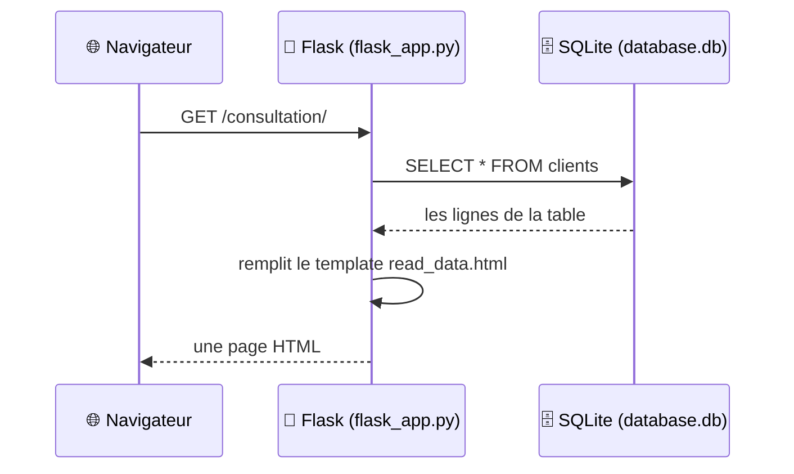

# 🟢 Exercice 2 — Afficher les données proprement

⏱️ ~20 minutes · [⬅️ Exercice précédent](01-explorer-la-base.md) · [Exercice suivant ➡️](03-rechercher.md)

## 🎯 Ce que vous allez découvrir

Quand vous visitez `/consultation/`, trois acteurs travaillent ensemble :



Vous allez comprendre ce circuit et rendre l'affichage **plus lisible et plus robuste**.

## 🛠️ À faire

### Partie A — Lire le code

Ouvrez `flask_app.py` et repérez la fonction `ReadBDD()`. Identifiez les 5 étapes : **se connecter**, **créer un curseur**, **exécuter la requête**, **récupérer les résultats** (`fetchall`), **fermer la connexion**.

Ouvrez ensuite `templates/read_data.html` : la boucle `` parcourt les lignes, et `row[2]` désigne… la 3ᵉ colonne. Pas très parlant !

### Partie B — Accéder aux colonnes par leur nom

1. Dans `flask_app.py`, modifiez la fonction `get_db()` :
   ```python
   def get_db():
       """Ouvre une connexion à la base de données SQLite."""
       conn = sqlite3.connect(DATABASE)
       conn.row_factory = sqlite3.Row  # pour écrire row['nom'] au lieu de row[2]
       return conn
   ```
2. Dans `templates/read_data.html`, remplacez les `row[0]`, `row[1]`… par `row['id']`, `row['created']`, `row['nom']`, `row['prenom']`, `row['adresse']`.
3. *Commit*, puis vérifiez que `/consultation/` fonctionne toujours.

### Partie C — Améliorer la page

1. Triez les clients par nom : modifiez la requête SQL de `ReadBDD()` pour ajouter `ORDER BY nom`.
2. Affichez le nombre de clients au-dessus du tableau. Dans le template :
   ```html
   <p>{{ data|length }} client(s) dans la base.</p>
   ```
3. Rendez le nom cliquable, pour ouvrir la fiche du client :
   ```html
   <td><a href="/fiche_client/{{ row['id'] }}">{{ row['nom'] }}</a></td>
   ```
4. Ajoutez un peu de style dans le `<head>` du template pour rendre le tableau lisible :
   ```html
   <style>
       table { border-collapse: collapse; }
       th, td { border: 1px solid #ccc; padding: 6px 12px; }
       th { background: #f0f0f0; }
   </style>
   ```

### Partie D — Gérer le client introuvable

Visitez `/fiche_client/999`. Que se passe-t-il ? Améliorez la fonction `Readfiche()` : si la requête ne renvoie rien, affichez un message clair avec le code d'erreur **404** :
```python
    if not data:
        return "<h2>Client introuvable</h2>", 404
```
(à placer juste avant le `return render_template(...)`).

## 👀 À observer

- Appuyez sur **F12** → onglet **Réseau**, puis rechargez `/consultation/`. Le navigateur reçoit-il du SQL ? Du Python ? Ou seulement du HTML ?
- Faites un clic droit → **Afficher le code source de la page** : les `` ont disparu. Qui les a remplacés ?

## 📝 Questions (à noter dans `CARNET.md`)

1. Décrivez avec vos mots le trajet d'une requête, du navigateur jusqu'à la base de données, puis le retour.
2. Pourquoi faut-il **fermer** la connexion (`conn.close()`) après chaque requête ?
3. Quel est l'avantage d'écrire `row['nom']` plutôt que `row[2]` ? (Pensez à ce qui arriverait si on ajoutait une colonne au milieu de la table.)
4. Pourquoi est-il préférable de trier avec `ORDER BY` dans la requête SQL plutôt qu'en Python ?

## 🧩 Défi

Créez un template `templates/fiche_client.html` dédié à l'affichage **d'un seul client** (pas un tableau, mais une fiche avec son nom en titre et ses informations en dessous), et utilisez-le dans `Readfiche()`. Indice : utilisez `cursor.fetchone()` au lieu de `fetchall()` pour récupérer une seule ligne.
