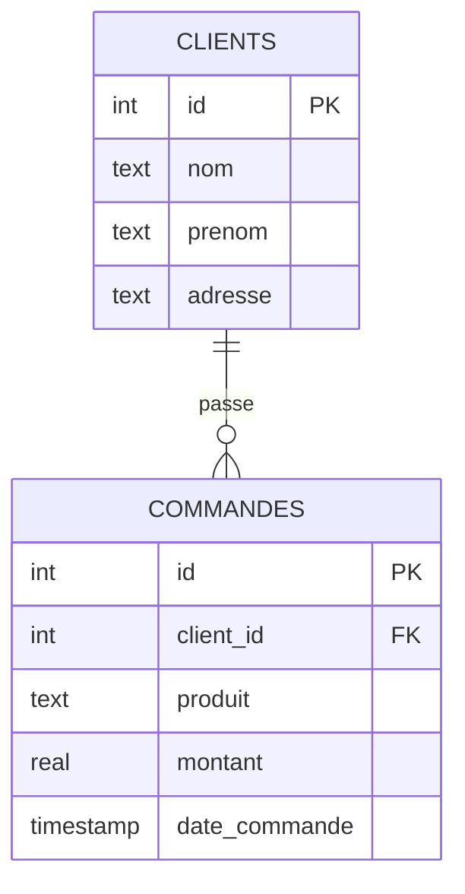

# 🟣 Exercice 7 — Relier deux tables

⏱️ ~40 minutes · [⬅️ Exercice précédent](06-faire-evoluer-la-base.md) · [Exercice suivant ➡️](08-controle-acces.md)

## 🎯 Ce que vous allez découvrir

Vos clients passent des **commandes**. Où les ranger ? Ajouter des colonnes `commande1`, `commande2`, `commande3`… à la table `clients` serait une très mauvaise idée (et s'il y en a 50 ?).

La bonne solution : une **deuxième table**, `commandes`, dont chaque ligne contient le **numéro du client** concerné. Ce numéro s'appelle une **clé étrangère** : c'est le lien entre les deux tables. C'est le « R » de base de données **relationnelle**.



> 🔑 C'est **exactement** la mécanique dont vous aurez besoin pour la bibliothèque : un **emprunt** relie un **livre** et un **utilisateur**.

## 🛠️ À faire

### Partie A — Créer la table

1. Dans la console **Bash** de PythonAnywhere : `cd ~/mysite` puis `sqlite3 database.db`, et créez la table :
   ```sql
   CREATE TABLE commandes (
       id INTEGER PRIMARY KEY AUTOINCREMENT,
       client_id INTEGER NOT NULL,
       produit TEXT NOT NULL,
       montant REAL NOT NULL,
       date_commande TIMESTAMP NOT NULL DEFAULT CURRENT_TIMESTAMP,
       FOREIGN KEY (client_id) REFERENCES clients (id)
   );
   ```
2. Ajoutez quelques commandes (vérifiez d'abord avec `SELECT id, nom FROM clients;` que les clients 2, 3 et 5 existent encore, sinon adaptez les numéros) :
   ```sql
   INSERT INTO commandes (client_id, produit, montant) VALUES (2, 'Clavier', 49.90);
   INSERT INTO commandes (client_id, produit, montant) VALUES (2, 'Souris', 19.90);
   INSERT INTO commandes (client_id, produit, montant) VALUES (3, 'Écran', 189.00);
   INSERT INTO commandes (client_id, produit, montant) VALUES (5, 'Casque', 79.00);
   INSERT INTO commandes (client_id, produit, montant) VALUES (5, 'Webcam', 59.00);
   INSERT INTO commandes (client_id, produit, montant) VALUES (5, 'Câble HDMI', 9.90);
   ```
3. Comme à l'exercice 6, **reportez la création de la table dans `schema.sql`** sur GitHub. Attention à l'ordre : au début du fichier, il faut supprimer `commandes` **avant** `clients` (une commande dépend d'un client) :
   ```sql
   DROP TABLE IF EXISTS commandes;
   DROP TABLE IF EXISTS clients;
   ```

### Partie B — La jointure (`JOIN`)

Toujours dans la console `sqlite3` (avec `.headers on` et `.mode column`), testez :
```sql
-- Les commandes seules : on ne voit qu'un numéro de client...
SELECT * FROM commandes;

-- ...la jointure va chercher le nom du client correspondant
SELECT commandes.id, clients.nom, clients.prenom, commandes.produit, commandes.montant
FROM commandes
JOIN clients ON commandes.client_id = clients.id;

-- Nombre de commandes et total dépensé par client (y compris ceux sans commande)
SELECT clients.nom, COUNT(commandes.id) AS nb_commandes, SUM(commandes.montant) AS total
FROM clients
LEFT JOIN commandes ON commandes.client_id = clients.id
GROUP BY clients.id
ORDER BY total DESC;
```

### Partie C — Afficher les commandes dans l'application

1. Créez une route `/commandes/` qui affiche **toutes les commandes avec le nom du client** (utilisez la première requête avec `JOIN`) dans un nouveau template `templates/commandes.html`.
2. Améliorez la fiche client (`/fiche_client/<id>`) : en plus des informations du client, affichez **la liste de ses commandes**. Il faut pour cela **deux requêtes** dans la même fonction :
   ```python
   cursor.execute('SELECT * FROM commandes WHERE client_id = ? ORDER BY date_commande DESC', (post_id,))
   commandes = cursor.fetchall()
   ```
   puis transmettre les deux résultats au template : `render_template('...', data=data, commandes=commandes)`.
3. Créez une page `/statistiques/` qui affiche le tableau « nombre de commandes et total par client ».

### Partie D — Faire respecter les liens

1. Dans la console `sqlite3`, essayez d'ajouter une commande pour un client qui n'existe pas :
   ```sql
   INSERT INTO commandes (client_id, produit, montant) VALUES (999, 'Fantôme', 1);
   ```
   Ça marche… et c'est un problème ! Supprimez cette commande orpheline (`DELETE FROM commandes WHERE client_id = 999;`).
2. Par défaut, SQLite **ne vérifie pas** les clés étrangères. Il faut l'activer à chaque connexion. Dans `flask_app.py`, modifiez `get_db()` :
   ```python
   def get_db():
       """Ouvre une connexion à la base de données SQLite."""
       conn = sqlite3.connect(DATABASE)
       conn.row_factory = sqlite3.Row
       conn.execute('PRAGMA foreign_keys = ON')  # faire respecter les clés étrangères
       return conn
   ```
3. *Commit*, puis essayez de **supprimer un client qui a des commandes** depuis `/consultation/`. Vous obtenez une erreur 500 : lisez l'**Error log**. SQLite a refusé la suppression, ce qui protège vos données !
4. Mais l'erreur s'est produite **avant** `conn.close()` : la connexion est restée ouverte et peut bloquer la base (erreur `database is locked` lors des écritures suivantes). Remplacez la fonction `supprimer_client()` pour **intercepter l'erreur** et **toujours** fermer la connexion :
   ```python
   @app.route('/supprimer_client/<int:id>', methods=['POST'])
   def supprimer_client(id):
       conn = get_db()
       try:
           conn.execute('DELETE FROM clients WHERE id = ?', (id,))
           conn.commit()
       except sqlite3.IntegrityError:
           return "<h2>Impossible de supprimer ce client : il a des commandes.</h2>", 409
       finally:
           conn.close()  # exécuté dans TOUS les cas, même après le return
       return redirect('/consultation/')
   ```
   (Si vous avez déjà fait l'exercice 8, gardez la vérification du rôle au début de la fonction.)

## 👀 À observer

- Quelle différence entre `JOIN` et `LEFT JOIN` dans la requête de statistiques ? (Essayez avec `JOIN` seul : certains clients disparaissent.)
- Pour un client sans commande, que vaut `total` ? Comment afficher `0` à la place ? (Indice : `COALESCE(SUM(commandes.montant), 0)`)
- Avec `PRAGMA foreign_keys = ON`, que se passe-t-il quand on supprime un client qui a des commandes ? Est-ce une bonne chose ?
- Que fait le bloc `finally` ? Pourquoi est-il indispensable ici ?

## 📝 Questions (à noter dans `CARNET.md`)

1. Qu'est-ce qu'une **clé étrangère** ? Dans quelle table se trouve-t-elle ici, et pourquoi pas dans l'autre ?
2. Pourquoi est-ce une mauvaise idée de créer des colonnes `commande1`, `commande2`… dans la table `clients` ?
3. À quoi sert un `JOIN` ? Et un `GROUP BY` ?
4. Pour la bibliothèque, quelles tables imaginez-vous ? Lesquelles contiendront des clés étrangères ?

## 🧩 Défi

1. Ajoutez sur la fiche client un **formulaire pour créer une nouvelle commande** pour ce client (produit + montant).
2. Améliorez le message de refus : « Impossible : ce client a 3 commandes », avec le vrai nombre (indice : `SELECT COUNT(*) ...`) et un lien vers sa fiche.
