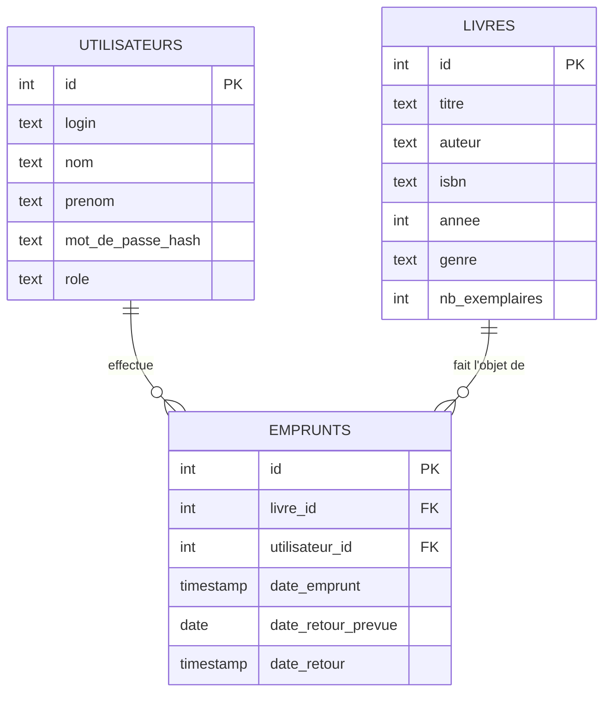

# 📚 Séquence 6 — Le projet de bibliothèque

⏱️ ~3 heures · [⬅️ Exercice précédent](09-api-json.md) · [Retour au sommaire](../README.md#-séquence-6--le-projet-de-bibliothèque)

## 🎯 Votre mission

La médiathèque de votre ville gère encore ses prêts sur un cahier. Elle vous demande de concevoir et développer une **application Web de gestion de bibliothèque** qui simplifie le prêt et le retour des livres.

Vous allez réutiliser **tout ce que vous avez appris** : chaque fonctionnalité correspond à un exercice que vous avez déjà réalisé sur les clients. Gardez vos exercices sous les yeux !

> 💡 **Conseil :** créez un **nouveau dépôt** (*Use this template* à nouveau) et une **nouvelle web app**… ou bien faites évoluer votre dépôt actuel. Dans tous les cas, avancez **par petites étapes**, et faites un *commit* (et un test en ligne) après chacune.

---

## 📋 Le cahier des charges

### Les fonctionnalités obligatoires

| # | Fonctionnalité | Qui ? | Exercices utiles |
|---|---|---|---|
| F1 | Enregistrer, modifier et supprimer un livre | Admin | 4, 5 |
| F2 | Gérer le stock : nombre d'exemplaires de chaque livre | Admin | 6 |
| F3 | Rechercher un livre (titre, auteur) et voir s'il est **disponible** | Tous les utilisateurs connectés | 3, 7 |
| F4 | Emprunter un livre disponible | User | 4, 7 |
| F5 | Rendre un livre emprunté | User (ou Admin) | 5, 7 |
| F6 | Voir la liste de **mes** emprunts en cours | User | 7, 8 |
| F7 | Gérer les utilisateurs (créer, lister, supprimer) | Admin | 4, 5, 8 |
| F8 | Contrôle d'accès **Utilisateur / Administrateur** | – | 8 |
| F9 | Une **API JSON** pour consulter les livres et leur disponibilité | – | 9 |

### Les règles de gestion

Votre application doit **refuser** les situations suivantes avec un message clair (et pas une erreur 500 !) :

- R1 — Emprunter un livre dont **tous les exemplaires** sont déjà empruntés.
- R2 — Emprunter **plus de 3 livres** en même temps.
- R3 — Supprimer un livre dont un exemplaire est **en cours d'emprunt**.
- R4 — Accéder aux pages d'administration sans être **admin** (code `403`).
- R5 — Enregistrer un livre sans titre ou sans auteur.

---

## 🗄️ Le modèle de données conseillé



Quelques questions de conception à vous poser (et à justifier dans votre carnet) :

- **Un emprunt en cours**, c'est un emprunt dont `date_retour` est encore `NULL`. Quand l'utilisateur rend le livre, on **ne supprime pas** l'emprunt : on remplit `date_retour`. Pourquoi est-ce préférable ?
- **La disponibilité** d'un livre n'est pas stockée : elle se **calcule** (`nb_exemplaires` moins le nombre d'emprunts en cours). Quel problème poserait une colonne `nb_disponibles` mise à jour à la main ?
  ```sql
  SELECT livres.*,
         livres.nb_exemplaires - COUNT(emprunts.id) AS nb_disponibles
  FROM livres
  LEFT JOIN emprunts ON emprunts.livre_id = livres.id AND emprunts.date_retour IS NULL
  GROUP BY livres.id;
  ```
- Le `role` vaut `'admin'` ou `'user'`. Les mots de passe sont **hachés** (défi de l'exercice 8).

---

## 🪜 Les étapes conseillées

Ne cherchez pas à tout faire d'un coup ! Chaque étape doit fonctionner **en ligne** avant de passer à la suivante.

| Étape | Objectif | C'est réussi quand… |
|---|---|---|
| **1. Le schéma** | Écrire le nouveau `schema.sql` (3 tables) et un `create_db.py` avec des données d'exemple (une dizaine de livres, un admin, deux users) | `.schema` dans la console `sqlite3` affiche vos 3 tables |
| **2. Le catalogue** | Page `/livres` : liste des livres avec leur disponibilité + recherche | On trouve « Le Petit Prince » en tapant `petit` |
| **3. La connexion** | Authentification à partir de la table `utilisateurs`, déconnexion, rôles | `user` ne peut pas ouvrir les pages d'admin (code 403) |
| **4. L'administration des livres** | Ajouter, modifier, supprimer un livre et son nombre d'exemplaires | Les règles R3 et R5 sont respectées |
| **5. Les emprunts** | Bouton « Emprunter » sur le catalogue, page « Mes emprunts » avec bouton « Rendre » | Les règles R1 et R2 sont respectées |
| **6. Les utilisateurs** | Pages d'administration des utilisateurs | L'admin peut créer un compte et la personne peut se connecter |
| **7. L'API** | `GET /api/livres`, `GET /api/livres/<id>` (avec disponibilité) | La réponse est un JSON valide |
| **8. La finition** | Une page d'accueil avec un menu, un style commun à toutes les pages | Un visiteur s'y retrouve sans connaître les URL |

> 💡 **Astuce pour l'étape 8 :** plutôt que de répéter le menu et le style dans chaque template, créez un `templates/base.html` et utilisez l'**héritage de templates** de Flask (`` et ``). Cherchez « Jinja template inheritance ».

> ⚠️ **Rappel :** quand vous changez la structure de la base, pensez à la mettre à jour **sur le serveur** (exercice 6). Pendant le développement du projet, relancer `create_db.py` est acceptable, puisqu'il n'y a pas encore de vraies données.

---

## 🚀 Pour aller plus loin (bonus)

Une fois les fonctionnalités obligatoires terminées, enrichissez votre application :

- ⏰ **Les retards :** une page admin listant les emprunts dont la `date_retour_prevue` est dépassée (`WHERE date_retour IS NULL AND date_retour_prevue < date('now')`), avec un bandeau d'alerte pour l'utilisateur concerné.
- 📊 **Les statistiques :** les 5 livres les plus empruntés, le nombre d'emprunts par mois, le genre préféré des lecteurs (`GROUP BY`). Pourquoi pas un graphique, avec une bibliothèque JavaScript comme Chart.js ?
- 💡 **Les recommandations :** « Les lecteurs qui ont emprunté ce livre ont aussi emprunté… », ou des livres du même genre que les derniers empruntés.
- 📅 **La réservation :** réserver un livre indisponible, et être prévenu quand il revient.
- 🔌 **Une API complète :** emprunter et rendre via `POST /api/emprunts`, protégée par le contrôle d'accès.

---

## 📦 Ce que vous devez rendre

1. L'**URL de votre application** en ligne, avec des **comptes de test** (un admin et un user) indiqués dans votre README.
2. L'**URL de votre dépôt GitHub**, dont le `README.md` présente :
   - les fonctionnalités réalisées (et celles qui ne le sont pas !) ;
   - le schéma de votre base de données ;
   - la liste de vos routes et de vos API.
3. Votre **`CARNET.md`** complété, y compris la partie « Projet ».

## ✅ Grille d'évaluation indicative

| Critère | Points |
|---|---|
| L'application est en ligne et fonctionne | 2 |
| Modèle de données (3 tables, clés étrangères, schéma à jour) | 3 |
| Gestion des livres et des stocks (F1, F2) | 3 |
| Recherche et disponibilité (F3) | 2 |
| Emprunts et retours (F4, F5, F6) | 3 |
| Gestion des utilisateurs et contrôle d'accès (F7, F8) | 3 |
| Règles de gestion R1 à R5 respectées | 2 |
| API JSON (F9) | 1 |
| Qualité : requêtes paramétrées (`?`), mots de passe hachés, code lisible, README | 1 |
| **Total** | **20** |
| Bonus (fonctionnalités supplémentaires) | jusqu'à +3 |
